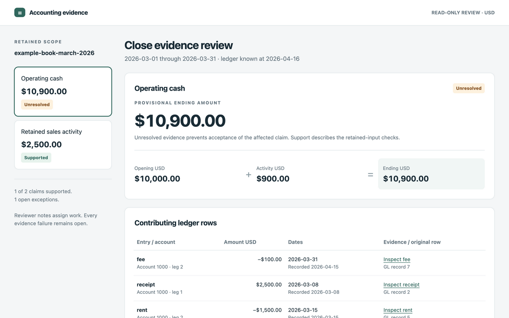

# Accounting Evidence Workbench

[](https://github.com/dbett4/accounting-evidence-workbench/actions/workflows/ci.yml)

Explain a reported amount from retained ledger rows, identify the source records it depends on, and keep unresolved differences visible.

This read-only Python CLI checks exact USD amounts, explicit account mappings, bank-to-ledger links, and invoice rollforwards. It emits a portable evidence pack, an exception register, and an offline review page. It was extracted from completed financial reporting automation work so the evidence controls can be run and inspected independently.



Fictional missing-support example. Cash of $10,900 remains provisional and unresolved; sales activity of $2,500 remains supported by its own retained evidence.

## Try it

Python 3.11 or later. The CLI and tests use only the standard library. No account, API key, database, or service is needed.

```bash
# From the repository root:
python3 scripts/demo.py --out artifacts/demo
python3 -m unittest discover -s tests -q
```

The demo runs seven checks using copied synthetic records. It checks a cash bridge, a mapped GL export, explicit bank links, a net settlement, and an invoice rollforward. It then removes rent support to show that cash becomes unresolved while revenue remains supported. Finally, it deletes the copied source inputs and verifies the earlier retained pack. The original fixtures stay unchanged.

To inspect one case directly:

```bash
python3 scripts/accounting_evidence.py explain \
  examples/accounting-evidence/manifest.bank.json --out artifacts/reviews
```

The response includes `pack_sha256`, `output`, and `review_html`. Open that HTML file locally to inspect the contributing ledger rows, bank coverage, source bytes, and exceptions. Each run retains:

| Artifact | Purpose |
| --- | --- |
| `pack.json` | Manifest, original UTF-8 source contents, and recomputable findings. |
| `exceptions.json` | Open findings with the affected claim IDs. |
| `review.md` | Balances, source revisions, and unresolved questions. |
| `views/HTML_DIGEST/review.html` | A self-contained review page with no remote assets. |

Optional installation adds an `accounting-evidence` command:

```bash
python3 -m venv .venv
. .venv/bin/activate
python -m pip install .
accounting-evidence --help
```

Installation uses setuptools as a build dependency. Runtime evaluation remains standard-library only. Source files and examples stay available through the direct commands above.

## Controls demonstrated

| Reporting problem | Implemented check |
| --- | --- |
| A source export changes after review. | Pin every declared source and mapping by SHA-256; flag a different revision. |
| A total agrees despite offsetting detail errors. | Check individual bank links and invoice balances as well as aggregate totals. |
| A missing source affects one amount. | Mark dependent claims unresolved while retaining unrelated supported claims. |
| Two equal amounts appear to match. | Show candidates; require explicit source-bound correspondence. |
| A later-recorded entry changes the view. | Keep effective dates, supplied recorded dates, and the `known_at` cutoff distinct. |
| Someone edits a saved pass result. | Recompute from retained inputs and compare against a separately retained pack digest. |
| A reviewer documents a disposition. | Bind classifications and next actions to the pack; leave evidence exceptions open. |

Money uses integer cents after strict decimal parsing. Unbalanced entries, duplicate legs, malformed CSV, stale mapping revisions, and unsupported allocations remain findings. The tool does not create balancing entries or silently discard invalid records.

The cash example is **$10,000 opening + $2,500 receipts − $1,500 rent − $100 fee = $10,900 ending**. The receivables example is **$2,000 opening invoices + $1,500 issuance − $1,900 collections = $1,600 ending invoices**, checked individually against the ending population.

## Design and evidence

The retained-input pipeline is manifest → capture → normalize → reconcile → report → review. Accounting modules live in `scripts/acfr_factory/` to preserve their extracted import structure. The original factory, its native-system connectors, and its delivery gates are outside this repository.

The extracted suite has **175 builder-run synthetic conformance tests**. It covers malformed inputs, a one-cent imbalance, missing and conflicting sources, ambiguous bank rows, offsetting invoice errors, stale links, tampered packs, offline replay, and safe HTML rendering. CI runs the suite and the real demo without credentials. These tests are authored expectations, not an independent accounting review or an evaluation of an AI model.

[Workflow and data contracts](docs/WORKFLOW.md) describe the commands and supported boundaries. [Source provenance](docs/PROVENANCE.md) records the completed implementation commit and per-file hashes. [Examples](examples/accounting-evidence/README.md) list each runnable case.

## Limits

The cash bridge is **not a full ASC 230 statement of cash flows**. The workbench does not provide GAAP certification, recognition-policy conclusions, source authentication, completeness outside the declared extract, or authenticated approval identities. It has no live Workiva/ERP connection and no posting or release authority.

Source summaries, account mappings, and business correspondence are explicit preparer assertions. A supported claim means the retained-input checks passed. A verified pack may still contain unresolved claims. Neither status establishes independent professional review, audit assurance, client readiness, or measured economic savings.

USD and the documented daily-date contracts are supported. PDF/OCR ingestion, FX, writeoffs, credit notes, general many-to-many allocations, and inferred historical opening balances need additional work.

## Rights

Public source with all rights reserved; no open-source license is granted. See [NOTICE.md](NOTICE.md).
